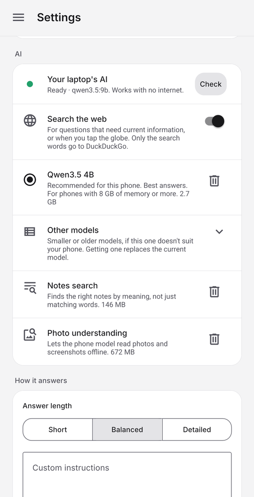

# Untethered

**Your private AI that works offline, on your phone and your computer.** No account, no subscription, no cloud.

| Drafts replies | Summarises PDFs you share | Runs on your own devices |
| :---: | :---: | :---: |
|  |  |  |

## Install

**Windows:** open PowerShell and run:

```powershell
irm https://raw.githubusercontent.com/latczar/untethered/main/install/install.ps1 | iex
```

**Android:** download `Untethered.apk` from the [latest release](https://github.com/latczar/untethered/releases/latest), install it and follow the set-up.

To link them, open Settings → Home on the computer and scan the QR code with the phone's camera. Untethered opens and asks before it pairs. (Or, on the phone, open Settings → Home, tap **Find my laptop** and enter the code shown on the computer.) Both need to be on the same Wi-Fi.

## Why Untethered

- **Works with no internet.** Aeroplane mode, off-grid, abroad without data: it still answers.
- **Private by design.** No account, no cloud, no analytics. Your phone and computer talk directly over your own Wi-Fi.
- **Its own offline library.** It answers from Wikipedia, WikiMed, Appropedia and other Kiwix libraries on your phone, and says which article it used.

## What it does

**Ask anything**
- Chats offline using AI models on your phone and your computer.
- Reads photos, PDFs and text files. On Android, share text, a screenshot or a PDF from any app to Untethered to ask about it.
- On Android, talk instead of typing, and have answers read aloud, using the phone's offline speech.
- Shows tables and dividers, and code you can copy with one tap.
- Picks up where you left off: the chat and screen you had open come back.

**Knows you, and you stay in charge**
- Learns lasting facts about you as you talk. See them, edit them or forget them in Memory.
- "Get to know me" asks a few questions so it starts off knowing you, and "Tidy up" finds duplicate or out-of-date facts for you to approve.
- Searches your notes when it answers, and follows your own instructions and preferred answer length.

**Answers from offline libraries** (Android)
- Searches Kiwix libraries (.zim files) for each question, gives the best passages to the AI, and names the article it used.
- Moves the libraries you already have in Kiwix into Untethered, without copying them.

**Phone and computer together**
- Pair them in a minute: scan the QR code on the computer with the phone's camera.
- At home, the phone uses the computer's bigger AI, and your memory and notes stay in sync.
- Choose Cool, Balanced or Max on the phone to trade speed against heat.

**Your data stays yours**
- On Android, an encrypted backup of your memory and notes is saved each day to a folder you choose. Restore it with your passphrase.
- Export and import memory and notes as a file.
- The internet is only used to download models and the libraries you choose. Every request from the phone to the computer is signed with your pairing code, and the hub's security tests are in this repository.

---

Copyright (c) 2026 Lattrell Caesar. Licensed under the GNU General Public License v3 or later (GPL-3.0-or-later), because the Android app includes Kiwix's reader. Third-party licences are in [THIRD_PARTY_LICENSES.md](THIRD_PARTY_LICENSES.md), and developer notes are in [docs/DEVELOPMENT.md](docs/DEVELOPMENT.md). Untethered isn't affiliated with Alibaba (Qwen), Ollama, Nomic, Hugging Face, Kiwix, Google or Samsung. AI can make mistakes.
