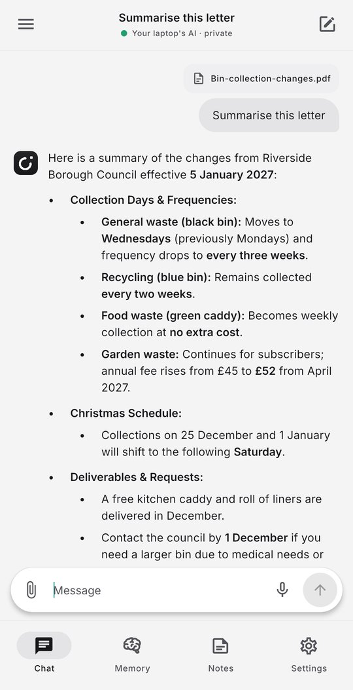

# Untethered

**Your private AI that works offline, on your phone and your computer.** No account, no subscription, no cloud.

| Drafts replies | Summarises PDFs you share | Runs on your own devices |
| :---: | :---: | :---: |
|  |  |  |

## Install

**Windows:** open PowerShell and run:

```powershell
irm https://raw.githubusercontent.com/latczar/untethered/main/install/install.ps1 | iex
```

**Android:** download `Untethered.apk` from the [latest release](https://github.com/latczar/untethered/releases/latest), install it and follow the set-up.

To link them, open Settings → Home on the phone, tap **Find my laptop** (or type the address), then enter the code shown in Settings → Home on the computer. Both need to be on the same Wi-Fi.

## What it does

- **Chats offline** using AI models on your own devices.
- **Learns about you** as you talk, and you can see and edit what it knows.
- **Reads your notes, photos and PDFs.** On Android, share text, a screenshot or a PDF from any app to Untethered to ask about it.
- **Answers from offline libraries.** On Android, Untethered searches Kiwix libraries (.zim files) such as Wikipedia or Appropedia for each question and names the article it used. It can move the libraries you already have in Kiwix, without copying them.
- **Syncs your phone and computer** over home Wi-Fi, and at home the phone uses the computer's bigger AI.

Everything stays on your devices. Nothing is collected.

---

Copyright (c) 2026 Lattrell Caesar. Licensed under the GNU General Public License v3 or later (GPL-3.0-or-later), because the Android app includes Kiwix's reader. Third-party licences are in [THIRD_PARTY_LICENSES.md](THIRD_PARTY_LICENSES.md), and developer notes are in [docs/DEVELOPMENT.md](docs/DEVELOPMENT.md). Untethered isn't affiliated with Alibaba (Qwen), Ollama, Nomic, Hugging Face, Kiwix, Google or Samsung. AI can make mistakes.
