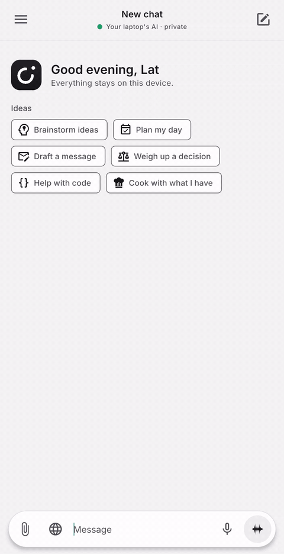

# Aislet

**Private offline AI with its own library, on your phone and your computer.** No account, no subscription, no cloud.

Say it "eye-let": AI plus islet, a private AI island. It was called Untethered until version 1.0.7.

| Drafts replies | Summarises PDFs you share | Runs on your own devices |
| :---: | :---: | :---: |
|  |  |  |

## Install

**Windows:** open PowerShell and run:

```powershell
irm https://raw.githubusercontent.com/latczar/aislet/main/install/install.ps1 | iex
```

**Linux and Mac:** install [Ollama](https://ollama.com/download) first, then open a terminal and run:

```bash
curl -fsSL https://raw.githubusercontent.com/latczar/aislet/main/install/install.sh | sh
```

Linux is tested on Ubuntu 24.04. The Mac version hasn't been tested yet; if you try it, please say how it went in an issue.

**Android:** download `Aislet.apk` from the [latest release](https://github.com/latczar/aislet/releases/latest), install it and follow the set-up. To get updates automatically, [add it to Obtainium](https://apps.obtainium.imranr.dev/redirect?r=obtainium://add/https://github.com/latczar/aislet).

To check you have the genuine app: the package is `app.untethered.assistant`, and the SHA-256 of its signing certificate is `25:C6:D2:76:14:C5:E6:1B:20:58:6B:A2:62:64:E9:A8:8F:B0:49:95:20:17:AD:98:C2:14:4B:F6:90:1C:1E:9A`.

To link them, open Settings → Home on the computer and scan the QR code with the phone's camera. Aislet opens and asks before it pairs. (Or, on the phone, open Settings → Home, tap **Find my laptop** and enter the code shown on the computer.) Both need to be on the same Wi-Fi.

## Why Aislet

- **Works with no internet.** On a plane, off-grid, abroad without data: it still answers.
- **Private by design.** No account, no cloud, no analytics. Your phone and computer talk directly over your own Wi-Fi. [How private is it?](#how-private-is-it)
- **Its own offline library.** It answers from your own PDFs, ebooks and documents, and from Wikipedia, WikiMed and other Kiwix libraries, and says which file or article it used.

## What it does

**Ask anything**
- Chats offline using AI models on your phone and your computer.
- Reads photos, PDFs and text files. On Android, share text, a screenshot or a PDF from any app to Aislet to ask about it.
- On Android, talk instead of typing, and have answers read aloud, using the phone's offline speech, in any language it has an offline speech pack for. Or go hands-free: speak, hear the answer, and keep talking.
- Shows tables and dividers, and code you can copy with one tap.
- Picks up where you left off: the chat and screen you had open come back.

**Knows you, and you stay in charge**
- Learns lasting facts about you as you talk. See them, edit them or forget them in Memory.
- "Get to know me" asks a few questions so it starts off knowing you, and "Tidy up" finds duplicate or out-of-date facts for you to approve.
- Searches your notes when it answers, and follows your own instructions and preferred answer length. Save any answer to Notes with one tap.

**Answers from offline libraries**
- Put your own PDFs, ebooks (EPUB), text, Markdown or saved web pages in the library folder: `Aislet/Libraries` on your phone, or `Documents/Aislet/Libraries` on your computer. Aislet searches them for each question, gives the best passages to the AI, and names the file and page or chapter it used.
- Aislet only reads your files. It never changes, moves or deletes them, and it reads each one once, again only when it changes.
- On Android, it also searches Kiwix libraries (.zim files) such as Wikipedia, and moves the ones you already have in Kiwix into Aislet, without copying them.

**Phone and computer together**
- Pair them in a minute: scan the QR code on the computer with the phone's camera.
- At home, the phone uses the computer's bigger AI, and your memory and notes stay in sync.
- Choose Cool, Balanced or Max on the phone to trade speed against heat.

**Your data stays yours**
- On Android, an encrypted backup of your memory and notes is saved each day to a folder you choose. Restore it with your passphrase.
- Export and import memory and notes as a file.
- Nothing you say goes online. See below for exactly what does.

## How private is it?

- **What goes online:** downloads, and nothing else. The phone downloads AI models from Hugging Face when you tap Download. The computer's installer downloads the app, and Ollama downloads its models. Libraries are files you add yourself.
- **What never does:** your chats, memory, notes, photos, PDFs, library files and voice. They're handled on your phone, or on your computer over your own Wi-Fi. There's no account, no analytics and no ads, and Android's cloud backup is off.
- **Voice:** the phone only uses its offline speech recognition. Phones without it don't get voice typing, rather than sending audio online, and the computer has no voice input for the same reason.
- **Phone to computer:** they talk directly on your home network. Every request is signed with your pairing code, which itself never crosses the network, and replayed or tampered requests are refused. A pairing QR code only works after you confirm it on the phone.
- **Check it yourself:** the [security model](docs/DEVELOPMENT.md#security-model) explains each protection, and the [hub's attack tests](pc/tests/hub_attack_test.py) try path tricks, forged, stale and replayed requests, cross-site requests and guessing the code. Or switch off Wi-Fi and mobile data: everything except downloads still works.

---

Copyright (c) 2026 Lattrell Caesar. Licensed under the GNU General Public License v3 or later (GPL-3.0-or-later), because the Android app includes Kiwix's reader. Third-party licences are in [THIRD_PARTY_LICENSES.md](THIRD_PARTY_LICENSES.md), and developer notes are in [docs/DEVELOPMENT.md](docs/DEVELOPMENT.md). Aislet isn't affiliated with Alibaba (Qwen), Ollama, Nomic, Hugging Face, Kiwix, Google or Samsung. AI can make mistakes.
